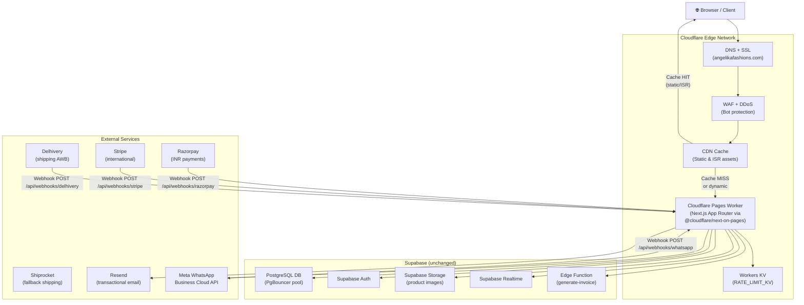

# Cloudflare Architecture — Angelika Fashions

> [!IMPORTANT]
> This document describes the **target architecture** after migrating from Vercel to Cloudflare Pages. No database migration is required — Supabase remains unchanged.

---

## Architecture Diagram



---

## Service Selection

| Service | Cloudflare Offering | Purpose | Why Chosen |
|---|---|---|---|
| **Hosting** | Cloudflare Pages | Serves Next.js App Router via edge workers | Zero cold-start globally, free unlimited bandwidth, native Workers integration |
| **Runtime adapter** | `@cloudflare/next-on-pages` | Transpiles Next.js build to Workers format | Official adapter, maintains Next.js compatibility |
| **Rate limiting** | Workers KV (`RATE_LIMIT_KV`) | Persistent rate limit counters across edge nodes | Replaces broken in-memory Map (stateless Workers env) |
| **DNS** | Cloudflare DNS | Authoritative DNS for angelikafashions.com | Instant propagation on Cloudflare-proxied records, free |
| **SSL/TLS** | Cloudflare Universal SSL | Automatic HTTPS for apex + www | Auto-provisioned, zero config, free |
| **WAF** | Cloudflare WAF (Basic) | DDoS mitigation, bot protection | Included with Cloudflare proxy, blocks layer 7 attacks |
| **Static assets** | Cloudflare CDN | Caches JS, CSS, images at edge | Global PoPs, stale-while-revalidate support |
| **Object storage** | Supabase Storage (retained) | Product image uploads | No migration needed; Cloudflare R2 is optional upgrade |
| **Database** | Supabase PostgreSQL (retained) | All application data | No migration needed |
| **Invoice generation** | Supabase Edge Function | PDF generation (replaces pdfkit) | Stateless serverless, no native module issues |

---

## Rendering Strategy

| Route | Strategy | Revalidation | Rationale |
|---|---|---|---|
| `/` (homepage) | ISR | 60 seconds | High-traffic, mostly static content; balance freshness vs. performance |
| `/products` | ISR | 300 seconds (5 min) | Catalog changes infrequently; edge cache reduces DB load |
| `/products/[slug]` | ISR | 300 seconds (5 min) | Per-product page; long enough to cache, short enough for price changes |
| `/cart`, `/checkout` | Dynamic (SSR) | No cache | User-specific, payment-critical — must never be stale |
| `/api/*` (REST API routes) | Dynamic | No cache | Server-only logic |
| `/api/webhooks/*` | Dynamic | No cache | Must process every request fresh; HMAC signature validation required |
| `/account/*` | Dynamic (SSR) | No cache | Auth-protected; session-specific |
| `/admin/*` | Dynamic (SSR) | No cache | RBAC-protected; real-time data required |
| `/_next/static/*` | Static (CDN) | Immutable (1 year) | Content-hashed filenames; safe for long-term caching |
| `/public/*` (images, icons) | Static (CDN) | 24 hours | Public assets, rarely change |

---

## Data Flow

### 1. Homepage Request (Cache HIT)

```
Browser
  → Cloudflare DNS resolves angelikafashions.com
  → WAF checks request (allow)
  → CDN: finds ISR-cached page (< 60s old)
  → Returns cached HTML directly to browser
  → DB not touched
```

### 2. Product Page (ISR — Cache MISS)

```
Browser
  → Cloudflare DNS → WAF → CDN: stale or missing
  → Cloudflare Pages Worker invoked
  → Worker fetches product data: Supabase PostgreSQL (via PgBouncer)
  → Worker renders React Server Component → HTML
  → Response stored in CDN cache (TTL 300s)
  → HTML returned to browser
  → Subsequent requests within 300s served from CDN (no DB hit)
```

### 3. Checkout (Dynamic — Passes Through Every Time)

```
Browser (authenticated session)
  → Cloudflare DNS → WAF (rate limit check via KV) → CDN: BYPASS
  → Cloudflare Pages Worker
  → Worker validates Supabase Auth session JWT
  → Worker reads cart from Supabase DB
  → Worker creates Razorpay/Stripe payment intent
  → Returns payment page HTML + client token
  → Browser completes payment on provider's SDK
  → Provider calls webhook → Worker
```

### 4. Webhook (Dynamic — All Payment/Shipping Providers)

```
Razorpay / Stripe / Delhivery / WhatsApp
  → POST /api/webhooks/{provider}
  → WAF: validates source IP where possible
  → Cloudflare Pages Worker
  → Worker: validates HMAC signature (provider-specific secret)
  → Worker: updates Supabase DB (order status, payment status)
  → Worker: triggers Resend email / WhatsApp notification
  → Returns 200 OK to provider
```

---

## Why Cloudflare Pages over Vercel?

| Factor | Vercel | Cloudflare Pages |
|---|---|---|
| **Cold starts** | ~200–500ms on hobby plan | Near-zero (V8 isolates) |
| **Bandwidth pricing** | Metered above free tier | Unlimited on all tiers |
| **Global edge nodes** | ~16 regions | 300+ PoPs |
| **Build minutes** | 6,000 min/month (Pro) | 500 builds/month (unlimited minutes each) |
| **Workers KV** | Not available natively | Built-in, tight integration |
| **Cost at scale** | Grows with function invocations | Flat $5/month Workers Paid covers 10M req/day |
| **Vendor lock-in** | Vercel-specific features | Standard Web APIs, portable |
